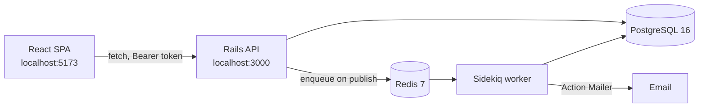
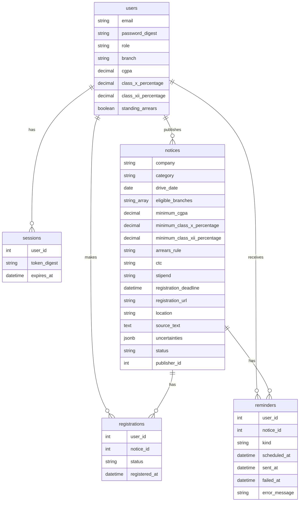
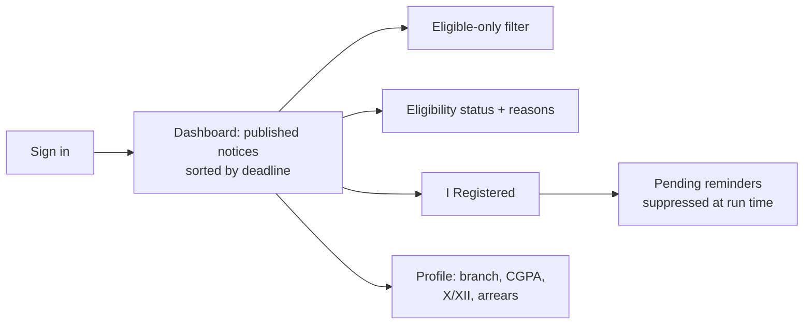
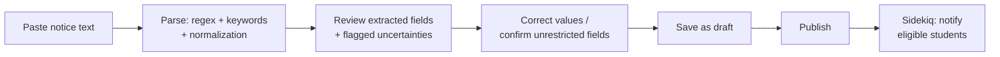
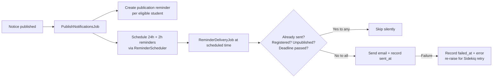

# PlacementPulse

A campus placement notice manager that turns long placement emails
into structured, coordinator-reviewed opportunities, tells each
student whether they are eligible and why, and sends registration
deadline reminders before the deadline passes.

## Problem

College placement coordinators distribute opportunities as lengthy
emails: company, designation, eligible branches, minimum CGPA, Class
X and XII percentages, arrears rules, CTC, stipend, drive date,
registration deadline, registration link, location. Students read
each one by hand to work out whether it applies to them, eligibility
rules are easy to misread, and registration deadlines get missed.
Coordinators then answer the same eligibility questions repeatedly,
and students have no single place to track what they registered for.

PlacementPulse addresses exactly that chain: parse the notice, let a
human review it, publish it once, explain eligibility per student,
track registrations, and remind eligible students before the
deadline.

## Features

- **Email/password authentication** for two roles, student and
  coordinator. No public signup: coordinator accounts are created
  directly in the database (or by seeds).
- **Deterministic notice parser** (regex, keyword matching,
  normalization — no LLM, no external service) that extracts all 13
  notice fields and flags uncertain fields instead of guessing.
- **Coordinator review and publication.** Paste, parse, correct,
  save as draft, publish. A notice with a missing required field that
  has not been confirmed as unrestricted cannot be published, and a
  missing requirement is never silently treated as unrestricted.
- **Student profiles** (branch, CGPA, Class X/XII percentages,
  standing arrears), editable only by their owner.
- **Explainable eligibility** — `eligible`, `not_eligible`, or
  `needs_clarification` — with a human-readable reason for every
  failed or uncertain criterion. Thresholds are inclusive: CGPA 7.5
  meets a 7.5 minimum.
- **Sidekiq notifications and reminders:** one publication
  notification per eligible student, plus reminders 24 hours and 2
  hours before registration closes. Reminders are suppressed when the
  student has registered, and every delivery job re-checks
  registration, publication status, and deadline at run time.
- **Student dashboard** with deadline sorting, an eligible-only
  filter, eligibility reasons, registration links, and an
  "I Registered" action.
- **REST API** with pagination, consistent error shapes, and
  role-based authorization enforced server-side.
- **Automated tests, CI configuration, measurement scripts, and this
  documentation.** What is not verified is labelled as such below
  and in `docs/testing-report.md`.

Deliberately out of scope: LLM/AI extraction, chatbots, WhatsApp,
SMS, push notifications, OAuth, payments, analytics dashboards,
microservices, and file uploads.

## Technology stack (actual versions)

Versions below are taken from `backend/Gemfile.lock` and
`frontend/package.json`, not guessed.

| Layer | Technology |
| --- | --- |
| Backend | Ruby 3.2.3, Rails 7.1.6 (API-only), Puma 8.0.2 |
| Database | PostgreSQL 16 (pg gem 1.7.0) |
| Queue | Sidekiq 8.1.7, Redis 7 (redis gem 6.0.0) |
| Mail | Action Mailer |
| Auth | `has_secure_password` (bcrypt 3.1.22), database session tokens |
| Frontend | React 19, TypeScript 5.9, Vite 7, Tailwind CSS 4 |
| Backend tests | RSpec 7.1.1, FactoryBot 6.5.1 |
| Frontend tests | Vitest 3.2, Playwright 1.64 |
| CI | GitHub Actions (see `.github/workflows/ci.yml`) |
| Local services | Docker Compose (configuration only — not run; see Deployment) |

## Architecture



## Database relationships



Key constraints: unique index on `LOWER(users.email)`; unique index
on `(registrations.user_id, notice_id)`; unique index on
`(reminders.user_id, notice_id, kind)`; unique index on
`sessions.token_digest`; check constraints for role, notice status,
arrears rule, reminder kind, and CGPA/percentage ranges. Indexes on
`notices.status`, `notices.registration_deadline`,
`notices.company`, and `reminders.scheduled_at`/`sent_at`.

## Student workflow



## Coordinator workflow



## Background job and reminder workflow



## API reference

All responses use `{ error: { message } }` for errors. Authenticated
requests send `Authorization: Bearer <token>`. Full backend detail is
in `backend/README.md`.

| Method & path | Role | Notes |
| --- | --- | --- |
| `POST /api/sessions` | anyone | `{ user: { email, password } }` → `{ user, token, expires_at }`. One generic 401 message for unknown email and wrong password alike. |
| `DELETE /api/sessions` | authenticated | Revokes the caller's session. |
| `GET /api/me` | authenticated | Current user. |
| `PATCH /api/profile` | student | Own profile only; role/email cannot be changed through it. |
| `GET /api/notices` | authenticated | Students see published only (a `status` param from a student is ignored). `eligible_only=true`, `page`, `per_page` (capped at 50), `meta` counts. |
| `GET /api/notices/:id` | authenticated | `source_text` only for coordinators; students get 404 for drafts. |
| `POST /api/notices/parse` | coordinator | `{ notice: { source_text } }` → `{ parsed, uncertainties }`. |
| `POST /api/notices` | coordinator | Always created as `draft`; `status` cannot be smuggled in. |
| `PATCH /api/notices/:id` | coordinator | Changing a published notice's deadline reschedules its unsent reminders. |
| `POST /api/notices/:id/publish` | coordinator | 422 + `uncertainties` when a required field is missing and not confirmed as unrestricted. Enqueues `PublishNotificationsJob`. |
| `GET /api/notices/:id/eligibility` | student | Coordinators get 403. |
| `POST /api/notices/:id/registration` | student | Idempotent: re-posting returns the same row, no duplicate. |
| `DELETE /api/notices/:id/registration` | student | Idempotent: returns `not_registered` even when nothing existed. |
| `GET /up` | anyone | Health check: 200 when the app boots. |

## Local setup

Prerequisites: Ruby 3.2, Node 24, PostgreSQL 16, Redis 7. Services
must be running before the backend starts (on Ubuntu, the build VM
used `pg_ctlcluster 16 main start` and `redis-server --daemonize
yes`; PostgreSQL needs a role matching the OS user running Rails).

```bash
# 1. Backend
cd backend
bundle install
bundle exec rails db:create db:migrate db:seed
```

Seeds create SYNTHETIC demo data only (invented users and an invented
notice — not real students or a real company):

- Coordinator: `coordinator@example.com` / `password1234`
- Student: `student@example.com` / `password1234`

```bash
# 2. Run the API, the worker, and the frontend in separate terminals
bundle exec rails server -p 3000
bundle exec sidekiq -C config/sidekiq.yml

cd ../frontend
npm install
npm run dev -- --port 5173
```

Open http://localhost:5173. The API is on http://localhost:3000
(`GET /up` returns 200 when the app boots).

## Environment variables

Copy `.env.example` to `.env` for local use. Never commit a real
`.env`, password, or master key.

| Variable | Purpose |
| --- | --- |
| `DATABASE_URL` | Full Postgres URL; overrides `config/database.yml` when set. Production uses this only. |
| `REDIS_URL` | Redis URL for Sidekiq (default `redis://localhost:6379/0`). |
| `SMTP_ADDRESS`, `SMTP_PORT`, `SMTP_USERNAME`, `SMTP_PASSWORD`, `SMTP_DOMAIN` | SMTP delivery. Development uses file delivery to `backend/tmp/mails/` when `SMTP_ADDRESS` is unset; test uses `:test` delivery. |
| `MAILER_FROM` | From address for notice emails. |
| `FRONTEND_ORIGIN` | Browser origin allowed by CORS (default `http://localhost:5173`). |
| `RAILS_MASTER_KEY` | Generate with `bin/rails credentials:edit`; keep the real key out of the repo. |
| `VITE_API_URL` | Frontend: API base URL (default `http://localhost:3000`). |

## Timezone

`config.time_zone` is `Asia/Kolkata`; timestamps are stored in UTC.
A notice deadline with no timezone is read as Kolkata time, and a
deadline date with no time is treated as 23:59 Kolkata time.

## Testing

See `docs/testing-report.md` for the full report, including what was
not run and why.

```bash
# Backend (from backend/)
bundle exec rails db:migrate db:seed
bundle exec rspec
# Re-run result, 2026-11-03: 83 examples, 0 failures

# Frontend unit/component tests (from frontend/)
npm test -- --run
# Re-run result, 2026-11-03: 6 tests passed, 0 failed, 2 files

# Frontend production build (from frontend/)
npm run build
# Re-run result, 2026-11-03: passed (tsc + Vite)

# End-to-end (from frontend/; backend must already be running on :3000)
npm run test:e2e
# Status: NOT RUN in this environment — the Chromium download failed
# repeatedly (see docs/testing-report.md). The spec
# (e2e/workflow.spec.ts) drives the full coordinator → student flow:
# coordinator logs in, pastes a synthetic notice, parses, saves a
# draft, publishes; a fresh browser context logs in as the student,
# sets the profile, sees the published notice with an eligibility
# status, checks the registration link target without navigating to
# it, clicks "I Registered", and sees Registered status.
```

## CI

`.github/workflows/ci.yml` has three jobs: `backend` (Ruby 3.2,
Postgres 16 and Redis services, `db:migrate`, RSpec), `frontend`
(Node 24, `npm ci`, Vitest, `tsc` + Vite build), and `e2e` (needs both,
migrates and seeds, starts the backend, runs Playwright). The YAML
was validated by parsing it, but it has **not** been executed on
GitHub — no login or connection was available — so no CI pass is
claimed.

## Deployment

No production deployment exists and none is claimed: no hosting
account or credentials were available. What is provided:

- `docker-compose.yml` — api, worker, postgres, redis, and frontend
  services. **Not run**: the Docker daemon is unavailable in the
  build environment, so this is untested configuration. Verify with
  `docker compose up` on a machine with Docker before relying on it.
- Environment-variable configuration (above), CORS restricted to
  `FRONTEND_ORIGIN`, HTTPS to be terminated by the host/reverse
  proxy, and database migrations run before the server starts
  (`bundle exec rails db:migrate`).

A production host needs: a Rails process, a Sidekiq worker process,
PostgreSQL with persistent storage, Redis, a React static build (or
the Vite dev server replaced by a static host), and an SMTP provider
with a verified sender domain. Secrets must come from the host's
secret store, never from the repository.

## Security and privacy

- Passwords: bcrypt hashes only (`password_digest`). No plaintext
  password is stored anywhere.
- Tokens: login returns a random token once; only its SHA256 digest
  is stored, with a 24-hour expiry. Logout deletes the session row
  (revocation). There is no public signup, so coordinator accounts
  cannot be self-created.
- Authorization is enforced in controllers, not in the UI: students
  cannot see drafts, cannot read `source_text`, cannot use the
  eligibility endpoint as coordinators, and cannot edit another
  student's profile.
- **Source text gating:** `source_text` is returned only to
  coordinators. Student-facing responses never include it, so raw
  placement-email content is not exposed to students or to public
  clients. Raw real notices must also never be committed to a public
  repository; see the privacy rules in `docs/measurement-plan.md`.
- **Exactly-once caveat (read before claiming anything):** the unique
  `(user, notice, kind)` index guarantees at most one reminder
  **row** per student, notice, and kind — duplicate publishes and
  duplicate job runs cannot create a second row, and a delivery job
  that runs twice will not re-send once `sent_at` is recorded. It is
  **not** a guarantee of exactly-once **email** delivery: if a worker
  crashes after the mailer sends but before `sent_at` is written, a
  retry can send the same email twice. No design here claims
  otherwise, and no test asserts otherwise.
- Demo credentials in seeds are development-only and must be changed
  before any shared use. Real student profiles and personal contact
  information must never be committed.

## Measurements

Status: **all six metrics are NOT RUN**. Protocols, scripts, and CSV
templates exist in `scripts/` and `docs/measurement-plan.md`; no
result exists yet, and `[MEASURE]` placeholders in
`docs/resume-bullets.md` mean exactly that.

| Metric | What it measures | Status |
| --- | --- | --- |
| M1 | Manual reading vs app eligibility decision time (10+ students × 5 notices, counterbalanced) | NOT RUN |
| M2 | Parser field-level accuracy on authorised real notices (target 30 notices) | NOT RUN |
| M3 | Reminder execution latency, p50/p95 | NOT RUN |
| M4 | Synchronous vs Sidekiq publish latency (delivery time kept separate) | NOT RUN |
| M5 | Dashboard query count and p95 before/after index and eager-loading work | NOT RUN |
| M6 | Two-week pilot: missed deadlines before vs during (descriptive, not causal) | NOT RUN |

Reminder evidence from healthcare research motivates the design but
does **not** prove a placement effect; see
`docs/research-summary.md`.

## Screenshots

None are included. Screenshots require a working Playwright browser,
and the browser download is blocked in this environment (see
`docs/testing-report.md`). No stock or fabricated image has been used
in their place. Capture them from the running app once a browser is
available and add them here with captions.

## Known limitations

See `docs/limitations.md` for the full list. In short: no production
deployment, Docker Compose unrun, GitHub push/CI unrun, real SMTP
inbox delivery not executed, Playwright run and screenshots blocked,
no real-notice parser accuracy, no survey or pilot, eligible-only
filter loads before paginating, and exactly-once email is not
guaranteed (see above).

## Documentation map

- `backend/README.md` — backend-only detail (auth, parser,
  eligibility, jobs, database, tests).
- `docs/architecture.md` — components, flows, data model, design
  rationale.
- `docs/testing-report.md` — verified counts and blocked items.
- `docs/measurement-plan.md` — M1–M6 protocols and templates.
- `docs/limitations.md` — what is not done and why.
- `docs/research-summary.md` — Part 1 sources and the gap hypothesis.
- `docs/interview-preparation.md` — pitches and 15 Q&As grounded in
  this code.
- `docs/resume-bullets.md` — Google XYZ bullets with verified counts
  and `[MEASURE]` placeholders.
- `scripts/README.md` — how the measurement scripts are run.

## License

MIT — see `LICENSE`.
